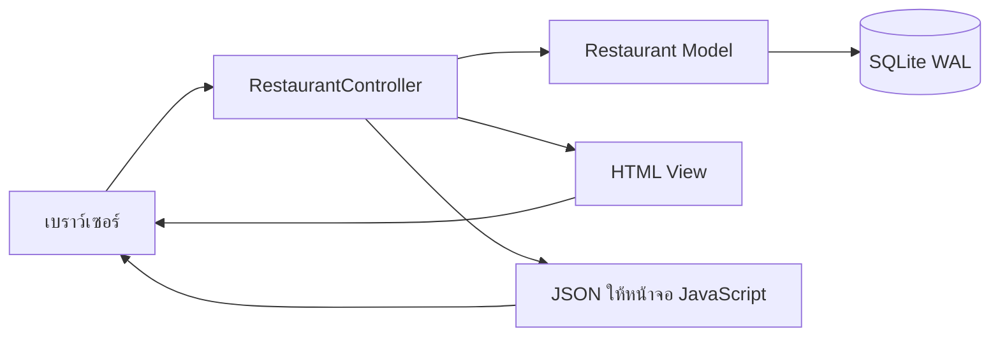
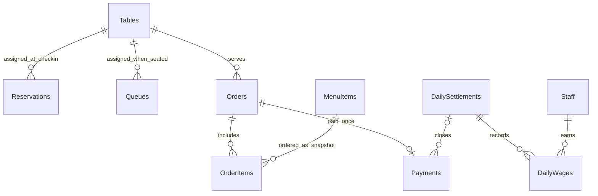
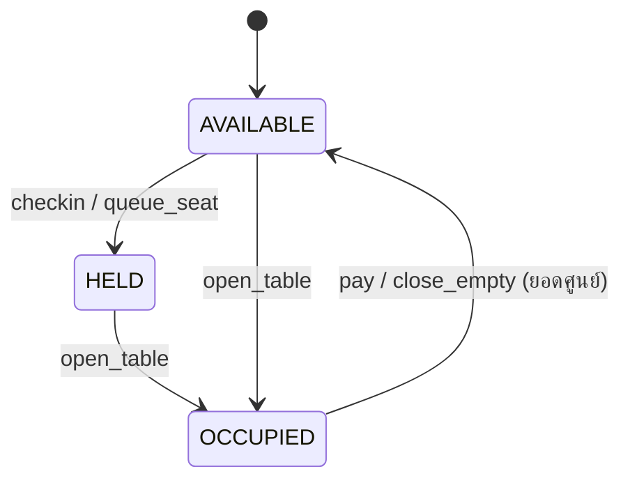
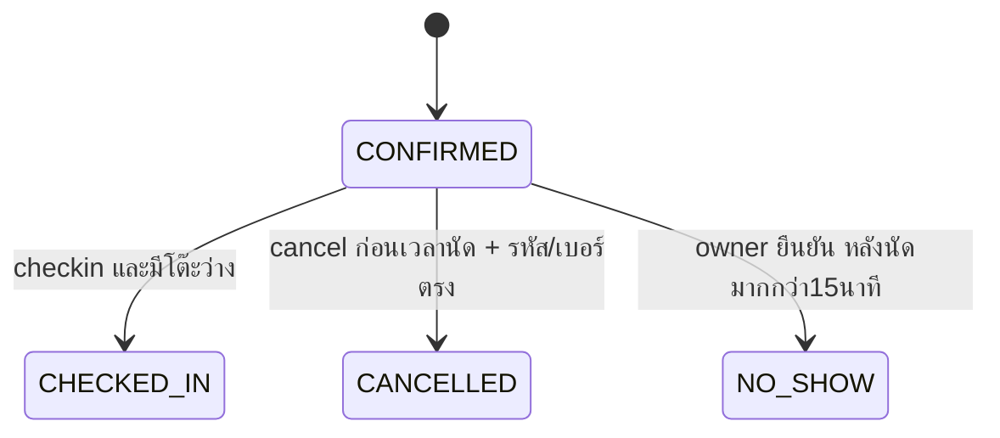

# โครงสร้างระบบและข้อมูล

## ลิงก์ทดสอบจากภายนอก

เมื่อรัน `preview.py` ใช้ฐานสาธิตเดิมและล็อกฐานหนึ่งชุด เปิดlocalhost8000สำหรับเจ้าของ และloopback8001ที่มีPreviewAccessก่อนทุกหน้า/API CloudflareTunnelเผยแพร่เฉพาะ8001ผ่านHTTPS originถูกกำหนดจากURLที่บริการส่งกลับ รหัสลิงก์สุ่มใหม่แต่ละรอบ cookieSecure/HttpOnly และจำกัดอายุ12ชม. การใช้บัญชีเจ้าของ/พนักงานยังถูกตรวจตามปกติ ไม่ใช้รหัสลิงก์แทนสิทธิ์ทางธุรกิจ ดูรายละเอียดการเปิด/หยุดใน REMOTE_PREVIEW.md

## ไฟล์หลักหลังปรับ MVC

| ไฟล์ | หน้าที่ |
|---|---|
| app.py | ประกอบ Model/Controller และเริ่มเซิร์ฟเวอร์ |
| models/restaurant.py | Model facade: permissions, transactions และอ่านข้อมูล |
| models/entities.py และ models/operations/ | Entity rules และการเขียนข้อมูลของ 23 commands ภายใน transaction |
| controllers/managers.py | CommandRouter และ Manager แยกตาม Use Case |
| models/menu_catalog.py | Model สำหรับนำเข้าและติดตามเมนู |
| controllers/http_controller.py | RestaurantController: HTTP, cookie, Host/Origin, routing และ response |
| views/documents.py | View สร้าง HTML ใบคิว QR ใบครัว ใบเสร็จ และรายงาน |
| views/templates/index.html | HTML หลัก |
| static/views.js | Boundary classes 18 คลาสแสดงหน้าจอ |
| static/app.js และ static/style.css | หน้าจอ โต้ตอบ ตะกร้า แบบฟอร์ม และรูปแบบคอมพิวเตอร์/มือถือ |
| config.py | ตำแหน่งโครงการและเขตเวลา |
| migrations/001_initial.sql ถึง 003_order_batches.sql | โครงสร้างและ constraints ฐานข้อมูลรุ่น 3 รวมเมนูและรอบออร์เดอร์ |
| service.py และ menu_catalog.py | ส่งต่อ import เก่าเพื่อความเข้ากันได้ |
| qr.py | QR encoder; ไม่เพิ่ม dependency |
| database_tools.py และ manage.py | ล็อกฐานข้อมูล สำรอง และ reset-demo แบบเก็บสำเนา |

ดูรายละเอียดการแบ่ง MVC และการปรับแผนภาพรายงานใน [MVC.md](MVC.md)

## ความสัมพันธ์ธุรกิจ

Reservations และ Queues อาจยังไม่มี Tables ที่ผูกไว้; Payments อาจยังไม่มี settlement ก่อนปิดบัญชี; Orders อาจไม่มี payment หากยังเปิดหรือปิดแบบยอดศูนย์ นอกจาก ER cardinality ปกติ ยังมี unique index จำกัด Orders.is_active=1 ต่อ table_id

## พจนานุกรมข้อมูลฉบับใช้งาน

ชนิด/PK/FK/NOT NULL/default/range แบบเต็มอยู่ใน `migrations/001_initial.sql` ถึง `003_order_batches.sql` ซึ่งใช้สร้างฐานจริง ตารางต่อไปนี้อธิบายหน่วยและฟิลด์ที่เพิ่มเพื่อไม่ให้สับสนกับแบบร่าง

| ตาราง | คีย์และข้อมูลสำคัญ |
|---|---|
| Tables | table_id PK; table_number UNIQUE; capacity 1–20 คน; status AVAILABLE/HELD/OCCUPIED |
| Reservations | reservation_id PK; reservation_code UNIQUE; customer_name, phone_number, reservation_datetime; guest_count 1–20; status; table_id FK nullable; created_at/updated_at |
| Queues | queue_id PK; queue_number UNIQUE ภายใน service_date; customer_name, phone_number (ว่างได้), guest_count, call_count 0–3; status; table_id FK nullable; created_at/updated_at |
| MenuItems | menu_id PK; name, category; price **สตางค์** ≥0; is_available 0/1 |
| Orders | order_id PK; session_token UNIQUE 32 อักขระสุ่มจาก 24 ไบต์; opened_at/closed_at; total_amount **สตางค์**; is_active 0/1; table_id FK |
| OrderItems | order_item_id PK; quantity 1–99; item_price **สตางค์** และ name_snapshot ตามเวลาสั่ง; note ≤255; ordered_at; order_id/menu_id FK |
| Payments | payment_id PK; order_id FK UNIQUE; payment_method CASH/MOCK_QR; total_paid, amount_received, change_amount **สตางค์**; payment_time; received_by FK Users; settlement_id FK nullable |
| DailySettlements | settlement_id PK; settlement_date UNIQUE; total_sales, material_cost, labor_cost, net_profit_loss, previous_loss, accumulated_loss, distributable_profit **สตางค์**; partner_shares JSON 4 จำนวนเต็ม; expected_cash/actual_cash/cash_difference **สตางค์**; difference_note; closed_by FK Users; closed_at |
| Staff | staff_id PK; name, role ตำแหน่งงาน; daily_rate **สตางค์ต่อวัน**; phone_number; is_active 0/1 — ไม่ใช่บัญชีเข้าสู่ระบบ |
| DailyWages | wage_id PK; settlement_id/staff_id FK UNIQUE คู่กัน; name_snapshot; wage_amount **สตางค์**; recorded_at |
| Users | user_id PK; username UNIQUE; password_hash เป็น PBKDF2-SHA256 + salt; role OWNER/STAFF; name |
| Sessions | token PK; user_id FK; expires_at อายุ 12 ชั่วโมง ใช้ cookie HttpOnly/SameSite=Strict |
| Settings | key PK; value; มี mode, slot_capacity และ owner_menu_installed |
| Requests | (scope,request_key) PK; body_hash, response JSON, created_at; เขียนพร้อมธุรกรรมธุรกิจเพื่อ replay คำขอเดิม |
| AuditLog | audit_id PK; actor (user ID หรือ CUSTOMER), action, entity_id, created_at; ไม่บันทึกรหัสผ่าน/เบอร์โทรใน audit |
| PrintJobs | job_id PK; kind QUEUE/SESSION/KITCHEN/RECEIPT; payload JSON snapshot; status PENDING/PRINTED/FAILED; attempts; created_at |
| MenuCatalog | source_key PK; menu_id UNIQUE FK; source_hash; review_note สำหรับพักรายการรอยืนยันราคา |
| OrderBatches | batch_id PK; order_id FK; status RECEIVED/PREPARING/READY/SERVED; updated_by FK nullable; kitchen_job_id UNIQUE FK; legacy |
| OrderBatchItems | (batch_id,order_item_id) PK; order_item_id UNIQUE; FK ไป OrderBatches และ OrderItems |
| OrderBatchEvents | event_id PK; batch_id FK; from_status/to_status; user_id FK nullable; created_at |

ทุกเวลาทางธุรกิจเก็บ ISO 8601 พร้อม `+07:00` และกรองวันด้วย prefix YYYY-MM-DD ไม่ใช้ timezone ของเครื่องตั้งค่าโดยบังเอิญ

## State ที่บันทึกจริง

## ขอบเขตธุรกรรมและความคงทน

ใช้ connection แยกต่อคำขอ เปิด foreign_keys/busy_timeout ทุกครั้ง ทุก mutation เริ่ม BEGIN IMMEDIATE ทำให้การตรวจโควตา/สถานะกับการแก้ข้อมูลมีผู้เขียนเพียงหนึ่งคนในช่วงนั้น อ่าน snapshot หน้าร้านอยู่ใน read transaction เดียว

| ธุรกรรม | สิ่งที่ commit พร้อมกัน |
|---|---|
| จอง | อ่านรอบ/โควตา → ตรวจข้อมูล → Reservations + Requests + AuditLog |
| เช็คอิน/จัดคิว | ตรวจสถานะและความจุโต๊ะ → Tables=HELD → Reservation/Queue สถานะใหม่ → audit/idempotency |
| เปิดโต๊ะ | ตรวจโต๊ะ → Tables=OCCUPIED → Orders token ใหม่ → SESSION PrintJobs → audit/idempotency |
| สั่งอาหาร | ตรวจ active session + availability + expected price → OrderItems ทั้งตะกร้า → recalc Orders.total_amount → KITCHEN PrintJobs → audit/idempotency |
| รับเงิน | ตรวจ active + ยอด + เงินรับ/Mock confirm → Payments → Orders ปิด → Tables=AVAILABLE → RECEIPT PrintJobs → audit/idempotency |
| ปิดบัญชี | ตรวจรายการค้าง/ปิดซ้ำ → คำนวณจาก Payments/Staff/รอบก่อน → DailySettlements → DailyWages → ผูก Payments → audit/idempotency |

เกิด exception ก่อน commit จะ rollback ทั้งชุด งานพิมพ์เป็น outbox ที่เปิดเอกสารภายหลัง ไม่ถือว่าการกดเปิดเอกสารคือพิมพ์กายภาพสำเร็จแล้ว

## การตรวจสิทธิ์และขอบเขตต้นแบบ

API ตรวจสิทธิ์จาก session ฝั่งเซิร์ฟเวอร์ ไม่เชื่อ role ที่เบราว์เซอร์ส่ง ไม่มี CORS การเขียนต้องมี Origin ตรงกับ base URL, application/json, X-SA-Request และ idempotency key ตรวจ Host เพื่อป้องกันการใช้โดเมนอื่นชี้เข้าเซิร์ฟเวอร์ในเครื่อง มีจำกัดการลอง login 15 ครั้งต่อนาที/IP และตั้ง Security headers

ระบบนี้เป็นต้นแบบ local HTTP server ไม่มีการอ้างว่าเป็นระบบพร้อมเผยแพร่สู่สาธารณะ ข้อจำกัดการใช้งานอยู่ใน README

## เมนูที่เจ้าของส่งเพิ่มเติม

`assets/menu/catalog.json` เก็บรายการ ชื่อ ขนาด ราคา หน่วยสตางค์ แหล่งภาพ และเหตุผลรอยืนยัน `menu_catalog.py` นำเข้าภายใน transaction เดียว โดย MenuCatalog.source_key เป็น PK และ menu_id เป็น UNIQUE FK ทำให้เริ่มโปรแกรมซ้ำไม่สร้างรายการซ้ำ ไม่เขียนทับเมนูที่เจ้าของแก้ภายหลัง

MenuCatalog.review_note ที่ยังมีข้อความขวางการสั่งทั้งเมนูหน้าลูกค้าและ place_order ฝั่งเซิร์ฟเวอร์ แม้ is_available ถูกเปลี่ยนผิด เมนูรอยืนยันไม่ได้แสดงราคา0บาทให้ลูกค้า เจ้าของต้องส่ง review_confirmed=true และราคามากกว่า0เพื่อปลดสถานะนี้ ส่วนเมนูราคา0ที่เจ้าของตั้งเองตามปกติยังทำงานตามเดิม

Migration จากv1เพิ่มตารางโดยไม่ลบ MenuItems/OrderItems และไม่แก้ snapshot ในบิลเก่า เมนูสาธิต6รายการเดิมปิดขายและติด source_key legacy-demo โดยเก็บแถวเดิมไว้ การนำเข้าจริงเกิดใน app.main หลัง initialize; ชุดทดสอบพื้นฐานยังเริ่มด้วย fixture6รายการและชุดทดสอบเมนูนำเข้าจะติดตั้ง catalog แยกเพื่อไม่ให้การเปลี่ยนข้อมูลเมนูบิดผลทดสอบธุรกรรมเดิม

## Presentation และภาพประกอบ

models/presentation.py สร้างข้อมูลผ่าน Restaurant.mutate และตรวจผลจาก SQLite จริง ใช้ data/presentation.sqlite3 มี marker ใน Settings และเวลาจำลองที่แสดงในหน้าจอ ไม่เพิ่มตารางหรือเปลี่ยน Entity เดิม ภาพเลือกตามหมวดผ่าน models/menu_images.py และ /api/config เก็บเป็นไฟล์ local ไม่ใส่ URL ภายนอกในรายการอาหาร ดู DEMO.md ที่ root
